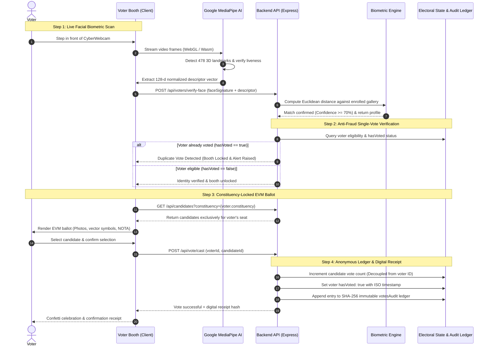

<div align="center">

# 🗳️ Smart Voting System (Voting_SM)
### *Next-Gen Biometric-Secured Anti-Fraud E-Voting & Real-Time Analytics Platform*

[](https://smart-voting-system-wyty.onrender.com/)
[](https://reactjs.org/)
[](https://vitejs.dev/)
[](https://developers.google.com/mediapipe)
[](https://tailwindcss.com/)
[](https://nodejs.org/)
[](https://expressjs.com/)
[](https://opensource.org/licenses/MIT)

<br/>

### 🔗 **Live Application URL:**
### 👉 [https://smart-voting-system-wyty.onrender.com/](https://smart-voting-system-wyty.onrender.com/) 👈

<br/>

> **A high-security, tamper-resistant digital voting platform featuring Google MediaPipe AI facial biometric authentication, anti-fraud single-vote locking, cryptographic audit ledgers, automated HelpDesk dispatch, and comprehensive coverage across all 234 Assembly Constituencies of Tamil Nadu.**

<br/>

[🌐 Live Demo](https://smart-voting-system-wyty.onrender.com/) • [✨ Features](#-comprehensive-feature-matrix) • [🔒 Biometric Workflow](#-security--biometric-workflow) • [🛠️ Tech Stack](#-technology-stack) • [🖥️ Portals](#-portal-walkthrough) • [🚀 Quick Start](#-quick-start-guide) • [☁️ Deploy on Render](#-deploy-on-render) • [📡 API Reference](#-api-documentation)

---

</div>

## 📌 Overview

The **Smart Voting System (Voting_SM)** is engineered to eliminate voter impersonation, prevent duplicate voting fraud, and provide transparent, real-time election monitoring. Designed with modern web technologies and computer vision AI, it features an interactive EVM ballot booth, strict administrative session guards, live voter turnout tracking, and executive analytics powered by interactive charts.

Modeled for large-scale elections like the **Tamil Nadu Legislative Assembly General Election 2026**, the system comes pre-loaded with official data for all **38 Districts**, **234 Constituencies**, and **970+ political candidates** (including TVK, DMK, AIADMK, BJP, NTK, PMK, Congress, Independents, and NOTA).

---

## ✨ Comprehensive Feature Matrix

### 👁️ 1. Google MediaPipe AI Facial Biometrics & Liveness
- **478 3D Facial Landmarks:** Real-time facial mesh extraction using Google MediaPipe Face Landmarker AI directly in the browser via WebAssembly and WebGL.
- **128-Dimensional Biometric Descriptor Vectors:** Normalized L2-norm Euclidean descriptor extraction calculated from facial geometry and blendshapes.
- **Real-Time 3D Cyber Face Mesh Overlay:** Live visual cybernetic reticle and mesh drawn dynamically over the webcam feed.
- **Dual-Retina Lock HUD:** Visual indicators confirming left and right retina lock before verification.
- **Anti-Spoofing & Lighting Validation:** Built-in lux and quality checks to reject spoofing attempts, photos-of-photos, and inadequate lighting conditions.
- **Automated 10-Frame High-Definition Enrollment:** Multi-frame capture pipeline that captures 10 progressive high-fidelity face frames, verifies lighting, and averages descriptor vectors for maximum accuracy.
- **Automatic 1:N Facial Recognition Search:** Instant biometric identification across the entire registered electoral database without requiring manual ID entry.
- **Prompt Unauthorized User Alert:** Visual warning with retry prompt if a face is not enrolled in the electoral roll.

---

### 🚫 2. Anti-Fraud Single-Vote Locking & Democratic Secrecy
- **One-Voter-One-Vote Guarantee:** Once a ballot is cast, the voter's database record is permanently marked with `hasVoted: true` and an ISO timestamp.
- **Instant Double-Vote Lockout:** Any subsequent attempt to access the ballot immediately locks the booth and raises an anti-fraud security alert (HTTP 409 Conflict).
- **Decoupled Ballot Vault (Voter Anonymity):** In accordance with democratic standards, voter identities are strictly decoupled from cast ballots. The audit ledger records the candidate, party, and constituency along with a cryptographic hash, ensuring ballot secrecy while maintaining auditable counts.
- **SHA-256 Digital Verification Receipts:** Generates an immutable transaction hash (`receiptHash`) for every successfully polled ballot.
- **Celebratory Confirmation Confetti:** Interactive celebratory canvas confetti triggers upon successful ballot submission.

---

### 🗳️ 3. Dynamic Constituency-Locked Digital EVM Ballot
- **Constituency-Locked Ballot:** Voters only see candidates contesting in their specific registered constituency out of Tamil Nadu's 234 assembly seats.
- **Candidate Profiles & Photos:** Displays high-resolution candidate photography, name, party banner, and official serial numbers.
- **High-Resolution Party Symbols:** Rich vector and SVG party symbols representing all major parties (TVK, DMK, AIADMK, BJP, NTK, PMK, INC, IND) and official NOTA.
- **Two-Step Vote Confirmation:** Modal confirmation dialog displaying the selected candidate and symbol before final submission to avoid accidental votes.

---

### 👤 4. Voter Registration & Electoral Directory Management
- **Live Biometric Enrollment:** Webcam photo capture with real-time MediaPipe AI face vector extraction.
- **Strict 18+ Age Verification:** Dynamic date-of-birth calculator that automatically validates whether the citizen meets the minimum legal voting age of 18 years.
- **Aadhaar Format Validation:** Enforces 12-digit Indian Aadhaar syntax with masked display (`XXXX-XXXX-1234`).
- **Digital Voter ID & Person ID:** Auto-generates unique electoral IDs (`VOTER-TN-...`) and sequential Person IDs upon enrollment.
- **Electoral Directory Management:**
  - View all registered citizens with real webcam enrollment photos.
  - Interactive photo zoom modal for detailed officer inspection.
  - Masked Aadhaar toggle (Show / Hide unmasked Aadhaar).
  - One-click Copy Voter ID to clipboard.
  - Multi-criteria filter by District, Constituency, and Status (All / Eligible / Already Voted).
  - Instant live search by Citizen Name, Voter ID, Aadhaar, or Phone number.
  - Individual voter deletion modal and bulk voter clear options.

---

### 🏛️ 5. Official 2026 Tamil Nadu Election Dataset & Candidate Management
- **Full Coverage of Tamil Nadu:** Pre-configured with all **38 Districts** and all **234 Legislative Assembly Constituencies**.
- **970+ Pre-Loaded Candidates:** Official candidates across all parties with constituency assignments and symbols.
- **Batch Dataset Ingestion via Excel (`.xlsx`):** Integrated SheetJS (XLSX) parser allowing election officers to upload spreadsheets to update candidate rosters in bulk.
- **Manual Candidate Addition:** Interactive modal to enroll new contesting candidates with custom symbol URLs, district, and constituency selection.
- **Candidate Search & Filter:** Filter by district, constituency, or search by candidate name in real-time.

---

### ⏰ 6. Polling Window & Active Session Controller
- **Scheduled Polling Hours:** Configurable election date and operating time window (e.g., 07:00 - 18:00 IST).
- **Automatic Booth Lock:** Prevents ballot access outside official polling hours with an informative lock screen.
- **Live Override Toggle:** Administrative toggle allowing officers to open or lock voting booths at any time for emergency controls or testing.
- **New Election Session Reset:** One-click administrative action to clear previous session ballot counts while preserving voter identity records.

---

### 📊 7. Executive PowerBI-Style Analytics Dashboard
- **First-Past-The-Post Grand Winner Showcase:** Real-time projected winning party card with seats won, lead declaration, and majority threshold indicator (118 / 234 seats).
- **Descending Seat Share Leaderboard:** Ranked list of parties by seats won, total votes polled, and seat share percentage.
- **Recharts Interactive Data Visualizations:**
  - Dynamic Bar Charts comparing candidate vote counts.
  - Pie Charts displaying overall vote share by political party.
- **Constituency Drilldown Winner Cards:** Displays leading candidate, runner-up, victory margin, and vote tally for every seat.
- **Interactive Slicers:** Filter analytics globally or slice by District (38 districts) and Constituency (234 seats).
- **Session Mode Toggle:** Switch between current active window telemetry and historical archive.
- **10-Second Live Auto-Refresh:** Continuous background polling keeping analytics synchronized with active voting booths.

---

### 🛡️ 8. Cryptographic Anti-Fraud Audit Ledger
- **SHA-256 Tamper-Proof Audit Trail:** Centralized ledger (`votesAudit`) storing verifiable proof for every cast ballot.
- **Auditable Transaction Log:** Includes audit ID, constituency, district, party voted for, timestamp, and unique cryptographic receipt hash.
- **Officer Dashboard Inspection:** Real-time log viewer displaying recent verified transactions.

---

### 🔒 9. Administrative Security & Session Guard
- **Role-Based Access Control:** Dedicated election officer portal separated from public voter booths.
- **Secure Officer Credentials:** Protected via environment variables (`ADMIN_USERNAME`, `ADMIN_PASSWORD`).
- **Admin Session Guard:** Automatically revokes administrative sessions when the officer switches tabs, minimizes the window, or navigates away, eliminating session hijacking risks.

---

### 🎫 10. Integrated HelpDesk & Automated Email Dispatcher
- **Floating HelpDesk Widget:** Always-accessible "Help Me" support modal available on all screens.
- **Automated Email Notifications via Nodemailer:** Election issue tickets submitted by voters are immediately formatted and emailed to the designated election officer inbox (`parthasarathi3046@gmail.com`).
- **Officer Ticket Log:** Inbound support tickets displayed in the Admin Command Center with timestamps, voter contact details, and issue descriptions.

---

## 🔒 Security & Biometric Workflow



---

## 🛠️ Technology Stack

| Layer | Technologies |
| :--- | :--- |
| **Frontend Framework** | [React 18.3](https://reactjs.org/) with [Vite 5.4](https://vitejs.dev/) |
| **Styling & Theme** | [Tailwind CSS 3.4](https://tailwindcss.com/) with Obsidian & Cyberpunk Dark Mode styling |
| **Biometric AI & Vision** | [Google MediaPipe Vision Tasks](https://developers.google.com/mediapipe/solutions/vision/face_landmarker) (`@mediapipe/tasks-vision` 1.1.1) |
| **Icons & UI Assets** | [Lucide React](https://lucide.dev/) (Comprehensive icon set) |
| **Charts & Visualizations**| [Recharts 2.15](https://recharts.org/) (Interactive Bar Charts, Pie Charts, Legends) |
| **UI Effects** | [Canvas Confetti](https://www.npmjs.com/package/canvas-confetti) |
| **Client Routing** | [React Router v6.29](https://reactrouter.com/) with `AdminSessionGuard` |
| **Backend Runtime** | [Node.js](https://nodejs.org/) (v18+) & [Express.js 4.21](https://expressjs.com/) |
| **File & Image Uploads** | [Multer 1.4](https://github.com/expressjs/multer) (Webcam base64 snapshots & multipart uploads) |
| **Email Service** | [Nodemailer 6.9](https://nodemailer.com/) (Automated HelpDesk ticket dispatch) |
| **Dataset Processing** | [SheetJS / XLSX 0.18](https://sheetjs.com/) (Excel spreadsheet parsing) |
| **State & Persistence** | In-memory database with atomic JSON synchronization (`election_state.json`, `tamilnadu_electoral_db.json`) |

---

## 🖥️ Portal Walkthrough

```
Smart-Voting-System
│
├── 🌐 Public Landing Page          ➜ Role selector (Voter Booth vs Election Officer)
├── 🗳️ Voter Portal (/voter)         ➜ Live facial biometric authentication & digital EVM ballot
├── 🔐 Admin Login (/admin/login)    ➜ High-security credential portal with session lock
├── 📊 Admin Command (/admin/dashboard) ➜ Turnout stats, fraud detection logs & status controls
├── 👤 Voter Registration (/admin/register-voter)
│   ├── Tab 1: Enroll Voter          ➜ Biometric webcam enrollment, Aadhaar & 18+ age checks
│   └── Tab 2: Electoral Directory   ➜ Search, masked Aadhaar toggle, photo zoom & filter
├── 📋 Candidate Management (/admin/candidates)
│   ├── 234 Seats Database           ➜ 970 pre-loaded candidates & vector party symbols
│   ├── Excel Batch Ingestion        ➜ One-click XLSX dataset upload
│   └── Polling Window Controller    ➜ Active hours configuration & live override
└── 📈 Executive Analytics (/admin/analytics)
    ├── Grand Winner Showcase        ➜ First-Past-The-Post majority projections (118/234)
    ├── Seat Share Leaderboard       ➜ Descending party rank by seats won
    ├── Recharts Bar & Pie Charts    ➜ Candidate comparisons & overall vote share
    └── Constituency Winner Cards    ➜ Seat-by-seat victory margins & telemetry
```

---

## 🚀 Quick Start Guide

### Prerequisites
- [Node.js](https://nodejs.org/) (`v18.0.0` or higher recommended)
- [Git](https://git-scm.com/)

### 1. Clone the Repository
```bash
git clone https://github.com/parthasarathi3004/Smart-Voting-System.git
cd Smart-Voting-System
```

### 2. Automated One-Click Launch (Windows)
Double-click the included batch script or run in terminal:
```cmd
start_project.bat
```
*This automatically starts the backend API on port `5000` and the Vite client on `http://localhost:5173`.*

---

### 3. Manual Step-by-Step Launch

#### Step A: Install Dependencies
```bash
# Install root dependencies
npm install

# Install server & client dependencies
npm run install:all
```

#### Step B: Configure Environment Variables
Copy `.env.example` in the `server` directory:
```bash
cp server/.env.example server/.env
```
Default credentials in `server/.env`:
```env
PORT=5000
NODE_ENV=development

# Officer Portal Credentials
ADMIN_USERNAME=parthasarathi
ADMIN_PASSWORD=partha@123
```

#### Step C: Start Development Servers
Run both backend and frontend concurrently:
```bash
npm run dev
```
Or run individually in separate terminals:
```bash
# Terminal 1: Backend API
npm run server

# Terminal 2: React Vite Client
npm run client
```

Now open **`http://localhost:5173`** in your browser!

---

## ☁️ Deploy on Render

> 🚀 **Live Production Deployment:** [https://smart-voting-system-wyty.onrender.com/](https://smart-voting-system-wyty.onrender.com/)

This repository is pre-configured for seamless, single-service deployment on **[Render](https://render.com/)** using the included `render.yaml` blueprint. In production mode, the Express backend serves the optimized Vite build directly.

### Option 1: One-Click Blueprint Deployment (Recommended)
1. Fork or push this repository to your GitHub account.
2. Go to your [Render Dashboard](https://dashboard.render.com/).
3. Click **New +** ➔ **Blueprint**.
4. Select your **`Smart-Voting-System`** repository.
5. Render will automatically detect `render.yaml`, set up the build command (`npm run build`), start command (`npm start`), and configure the Node environment.
6. Click **Apply**! Your app will be live with a free HTTPS `.onrender.com` URL in minutes.

### Option 2: Manual Web Service Setup on Render
If you prefer configuring manually in the Render dashboard:
1. Click **New +** ➔ **Web Service**.
2. Connect your GitHub repository.
3. Configure the following settings:
   - **Name:** `smart-voting-system`
   - **Language / Runtime:** `Node`
   - **Branch:** `main`
   - **Build Command:** `npm run build`
   - **Start Command:** `npm start`
   - **Instance Type:** `Free`
4. Add the following **Environment Variables**:
   - `NODE_ENV` = `production`
   - `ADMIN_USERNAME` = `parthasarathi`
   - `ADMIN_PASSWORD` = `partha@123` *(or your custom password)*
5. Click **Create Web Service**!

---

## 📡 API Documentation

The backend exposes structured RESTful endpoints:

| Method | Endpoint | Description |
| :--- | :--- | :--- |
| `GET` | `/api/health` | Healthcheck and platform status |
| `POST` | `/api/auth/login` | Authenticate election officer credentials |
| `GET` | `/api/voters` | Retrieve registered electoral directory |
| `POST` | `/api/voters/register` | Enroll voter with MediaPipe face descriptor vector & webcam snapshot |
| `POST` | `/api/voters/verify-face` | Verify voter via live facial biometric descriptor & 1:N matching |
| `DELETE` | `/api/voters/:id` | Delete an individual enrolled voter |
| `POST` | `/api/voters/clear-all` | Clear all registered voters |
| `GET` | `/api/candidates` | Get candidates filtered by district or constituency |
| `POST` | `/api/candidates` | Add new candidate profile and symbol |
| `POST` | `/api/candidates/upload-dataset` | Batch import candidate roster via Excel (`.xlsx`) |
| `GET` | `/api/candidates/meta/districts-and-constituencies` | Fetch list of all 38 districts & 234 seats |
| `GET` | `/api/candidates/meta/parties` | Fetch list of registered political parties & symbols |
| `POST` | `/api/vote/cast` | Submit confidential ballot to decoupled vault & update audit ledger |
| `GET` | `/api/vote/audit-ledger` | Retrieve SHA-256 tamper-proof transaction audit ledger |
| `GET` | `/api/election/config` | Retrieve polling window configuration & active poll status |
| `POST` | `/api/election/config` | Update election hours, scheduled window, and session parameters |
| `POST` | `/api/election/new-session` | Administrative reset to start a fresh voting session |
| `GET` | `/api/analytics` | Retrieve turnout, seat projections, leaderboards, and candidate charts |
| `POST` | `/api/support/ticket` | Submit issue to HelpDesk with automated Nodemailer email notification |
| `GET` | `/api/support/tickets` | Retrieve list of submitted HelpDesk tickets |

---

## 👨‍💻 Author

**Parthasarathi**
- GitHub: [@parthasarathi3004](https://github.com/parthasarathi3004)
- Repository: [Smart-Voting-System](https://github.com/parthasarathi3004/Smart-Voting-System)

---

## 📄 License

Distributed under the **MIT License**. See `LICENSE` for more information.

<div align="center">
  <sub>Built with ❤️ for secure, transparent, and modern democratic elections.</sub>
</div>
